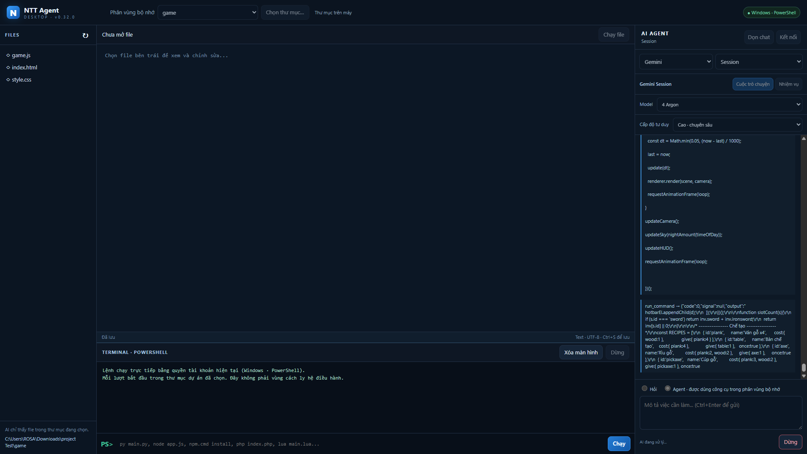

# NTT Agent Desktop

Ứng dụng AI hỗ trợ lập trình trên Windows. Bạn chọn một thư mục dự án; AI có thể đọc và sửa file trong đó, chạy lệnh bằng PowerShell, rồi kiểm tra kết quả.



> **Tình trạng:** Dự án đang phát triển. Tính năng Session dùng luồng web không có cam kết ổn định từ nhà cung cấp; API chính thức là lựa chọn phù hợp hơn cho công việc cần độ tin cậy.

## Tính năng

- **Gemini:** kết nối bằng API key hoặc Session đã đăng nhập trong cửa sổ web của app. Có lựa chọn model Gemini Session, gồm Argon.
- **DeepSeek:** kết nối bằng API key hoặc Session; Session có DeepThink và Web Search.
- **Other:** nhập URL backend, model và API key cho endpoint tương thích giao thức Anthropic Messages (`/v1/messages`). Chấp nhận HTTPS; HTTP chỉ dành cho `localhost`.
- **Agent lập trình:** liệt kê, đọc và sửa file trong thư mục dự án; chạy terminal, test chương trình và tiếp tục thực hiện khi thiếu runtime hoặc thư viện cần thiết.
- **Terminal Windows:** PowerShell 5.1, dùng chương trình đã cài trên máy. Agent có thể cài công cụ cần thiết theo quyền tài khoản hiện tại.
- **Editor:** tô màu cú pháp theo phần mở rộng file, có lưu file và chạy nhanh các định dạng thông dụng.
- **Phân vùng bộ nhớ:** trỏ thẳng tới thư mục trên máy; file dự án không bị chép sang một vùng riêng của app.

App không cần Docker Desktop hay Linux containers.

## Yêu cầu

- Windows với Windows PowerShell 5.1.
- Node.js và npm để cài dependencies và chạy mã nguồn.
- Một trong các cách kết nối AI được app hỗ trợ. Dùng API key cần có khóa từ nhà cung cấp; dùng Session cần đăng nhập vào tài khoản trong cửa sổ web của app.

## Chạy từ mã nguồn

```powershell
git clone https://github.com/OWNER/REPOSITORY.git
cd REPOSITORY
npm install
npm start
```

Thay `OWNER/REPOSITORY` và `REPOSITORY` bằng tên repository của bạn. Trên Windows, có thể mở `start.bat`; file này cài dependencies nếu chưa có Electron rồi chạy app.

Tạo bộ cài Windows:

```powershell
npm run dist:win
```

Kiểm tra mã nguồn:

```powershell
npm test
```

## Kết nối AI

Mở **Kết nối** rồi chọn cách dùng:

- **API key:** dùng khóa Gemini hoặc DeepSeek. App mã hóa khóa bằng Electron `safeStorage` trước khi lưu trong dữ liệu ứng dụng trên máy.
- **Session:** đăng nhập tại cửa sổ web nhúng trong app, rồi bấm **Kiểm tra**. Gemini và DeepSeek có thể dùng chung phiên Google; tài khoản DeepSeek vẫn có thể yêu cầu xác nhận riêng.
- **Other:** nhập URL backend, model và API key nếu cần. Backend phải trả về định dạng Anthropic Messages.

Chọn **Hỏi** để trò chuyện. Chọn **Agent** và thư mục dự án để AI thao tác file hoặc terminal khi tác vụ cần. Nút **Dừng** hủy tác vụ hiện tại; **Dọn chat** xóa lịch sử trò chuyện đã lưu trong app.

## Quyền truy cập và dữ liệu

- Công cụ đọc, ghi và liệt kê file của Agent bị giới hạn trong thư mục dự án đã chọn; chúng chặn đường dẫn thoát khỏi thư mục và symbolic link.
- Lệnh terminal chạy trực tiếp trên máy bằng quyền của tài khoản Windows hiện tại. Thư mục dự án là thư mục bắt đầu, **không phải sandbox**: một lệnh có thể truy cập file khác mà tài khoản Windows có quyền truy cập. Chỉ dùng Agent với yêu cầu và mã nguồn bạn tin cậy.
- API key được xử lý qua `safeStorage`. Lịch sử chat, cài đặt và dữ liệu đăng nhập Session được lưu cục bộ trong dữ liệu ứng dụng của Electron.
- Nội dung bạn gửi và ngữ cảnh file mà Agent đọc có thể được chuyển tới nhà cung cấp AI được chọn để tạo câu trả lời. Kiểm tra chính sách dữ liệu của nhà cung cấp trước khi dùng mã hoặc thông tin riêng tư.
- Session tương tác với website chính thức trong cửa sổ của app, nhưng phần tích hợp dùng các endpoint web không có cam kết hỗ trợ như API công khai. Website có thể đổi giao thức hoặc yêu cầu xác minh; app không vượt CAPTCHA hay bước đăng nhập. Claude Session và ChatGPT Session hiện không được hỗ trợ.

## Cấu trúc chính

| Đường dẫn | Nội dung |
| --- | --- |
| `main.cjs`, `preload.cjs` | Electron main process và cầu IPC giới hạn |
| `lib/agent.cjs` | Vòng lặp Agent, công cụ và hướng dẫn thực thi |
| `lib/territory.cjs` | Thư mục dự án và thao tác file |
| `lib/native-terminal.cjs` | PowerShell, output, timeout và dừng tiến trình |
| `lib/providers.cjs`, `lib/settings.cjs` | API provider, model, API key và lịch sử chat |
| `lib/web-session.cjs`, `lib/private-session.cjs` | Cửa sổ đăng nhập và Session Gemini/DeepSeek |
| `lib/session-scripts/` | Luồng request của từng Session |
| `renderer/` | Giao diện app, editor và tô màu cú pháp |
| `test/` | Unit test, request fixture và mô phỏng session |

## Phát triển

Tạo nhánh riêng cho thay đổi, chạy `npm test`, rồi mở pull request mô tả thay đổi và kết quả kiểm tra. Bài test Session dùng fixture/mô phỏng; chúng không xác nhận đăng nhập hoặc phản hồi bằng tài khoản nhà cung cấp thật.

## License

Repository hiện chưa có file `LICENSE`. Hãy chọn giấy phép và thêm file tương ứng trước khi phát hành công khai hoặc nhận đóng góp.
